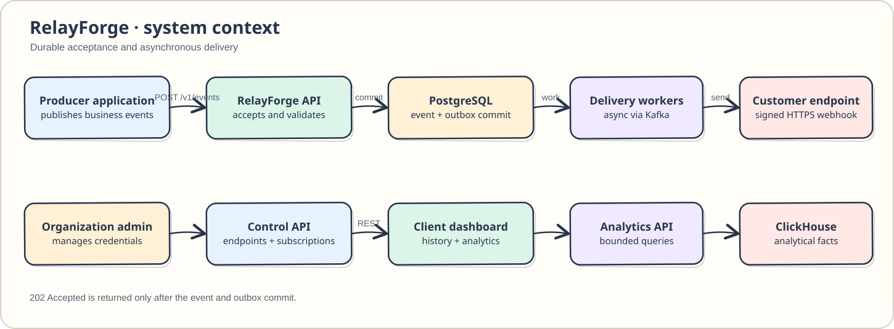
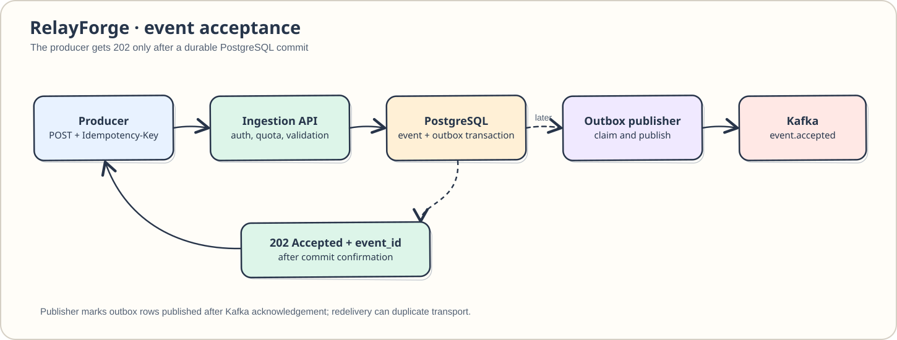
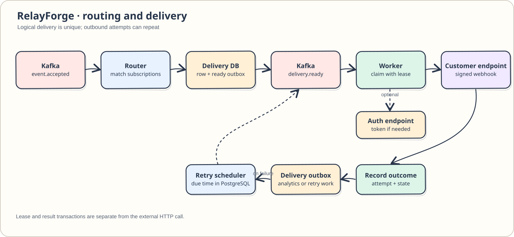
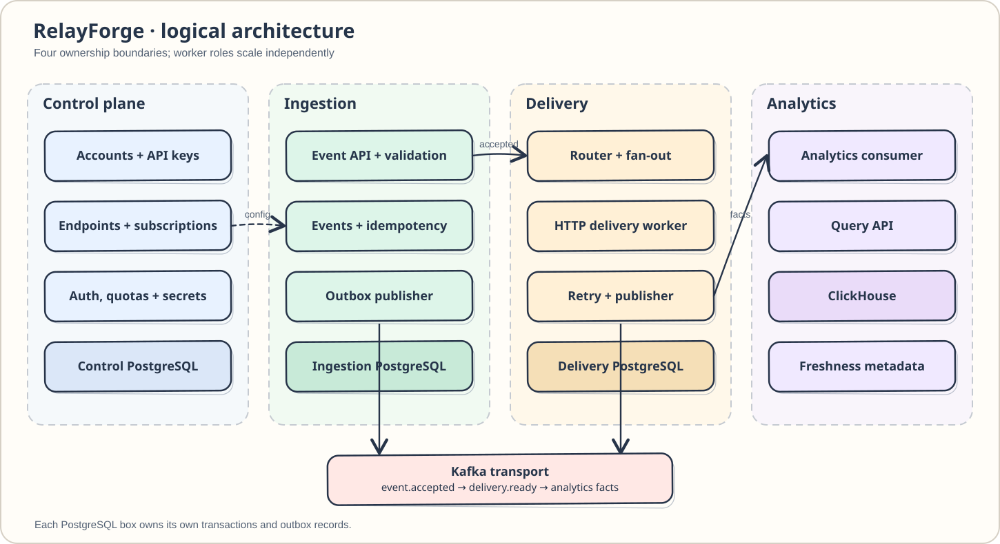

# RelayForge

RelayForge accepts customer events and delivers them as webhooks to registered endpoints. Customers configure accounts, API keys, endpoints, and subscriptions; producers submit events with an idempotency key. RelayForge durably accepts each event before routing it to matching endpoints, retrying eligible failures, and recording delivery history and analytics.

The repository has runnable Spring Boot role scaffolds, owner-specific database migrations, and a Docker Compose development stack. Business endpoints and end-to-end event delivery remain implementation tasks. Follow the [implementation checklist](RelayForge_Implementation_Checklist.md) for the build sequence.

## High-level design









## Implementation stack

| Component | Planned role |
|---|---|
| Java 21, Spring Boot, Maven | Service and worker applications; Maven reactor for the modules |
| PostgreSQL, Flyway | Authoritative service-owned data, local outboxes, and migrations |
| Kafka | Asynchronous event, delivery-work, and analytics-fact transport |
| Redis | Short-lived quota, token-cache, and coordination state |
| ClickHouse | Eventually consistent delivery analytics |
| Docker Compose | Local functional and integration environment |

PostgreSQL holds accepted events and active delivery state; Kafka messages may repeat, so consumers must be idempotent. The [HLD](RelayForge_High_Level_Design.md), [LLD](RelayForge_Low_Level_Design.md), [physical schema plan](docs/schema/README.md), and [image matrix](deploy/README.md) contain the detailed contracts.

## Design load estimates

Planning assumes **100 customer accounts**, **10,000 active endpoints**, average fan-out of **3 deliveries per accepted event**, and **1.1 outbound attempts per delivery**. Estimated outbound attempts/s = accepted events/s × 3 × 1.1.

| Profile | Accepted events/s | Estimated outbound attempts/s | Intended use |
|---|---:|---:|---|
| Normal | 5,000 | 16,500 | Sustained planning load |
| Peak | 10,000 | 33,000 | Burst planning load |
| Headroom | 15,000 | 49,500 | Peak plus 5,000 events/s |

These are design assumptions, not measured capacity. At a continuous normal rate for 90 days, the plan implies about **38.88 billion events**, **116.64 billion deliveries**, and **128.30 billion outbound attempts**, before auxiliary records. Event and delivery history become unavailable after 90 days; daily partition removal normally has a planned physical grace of up to 25 hours, with blocked drops treated as incidents. Account and configuration records are not age-purged. Shard count, hardware, burst duration, and the final throughput claim depend on load tests after functional implementation.

## Local setup

Install **JDK 21** and **Maven**, then run from the repository root:

```bash
java -version
mvn -version
mvn validate
mvn test
```

`mvn validate` checks the reactor layout and Java Checkstyle rules; `.editorconfig` defines four-space indentation. `mvn test` runs the bootstrap and PostgreSQL 17.11 Testcontainers migration tests, so Docker must be running. Each deployable module has a Spring Boot entry point. To run the control-plane bootstrap locally, use `mvn package` followed by `java -jar relayforge-control-plane/target/relayforge-control-plane-0.1.0-SNAPSHOT.jar`, then inspect `http://localhost:8080/health/live`. In Compose, `/health/ready` checks each role's required PostgreSQL, Kafka, or ClickHouse dependency.

The control-plane, ingestion, and delivery-api images apply their own Flyway migration at startup when `SPRING_FLYWAY_URL`, `SPRING_FLYWAY_USER`, and `SPRING_FLYWAY_PASSWORD` are set. Point each role at a separate PostgreSQL 17 database; ingestion and delivery use one database per shard. Bootstrap creates yesterday, today, and seven future UTC-day partitions. The migration tests verify a second apply leaves the schema history unchanged, and exercise local uniqueness, ownership, and partition boundaries. See [schema ownership and retention](docs/schema/README.md) for the remaining operational jobs.

Build a role image with `docker build -f deploy/Dockerfile.service --build-arg MODULE=relayforge-control-plane -t relayforge/control-plane:local .`. Replace the module and image name for another role.

### Docker development stack

Create a local `.env` with generated credentials before starting Compose. The file is ignored by Git; `.env.example` holds image versions, internal URLs, ports, and credential placeholders. Keep local credentials in `.env` and use an external secret manager for production.

```bash
python3 scripts/create-env.py
docker compose up -d --build
docker compose ps
docker compose run --rm test-ingestion
docker compose logs -f control-publisher router delivery-worker
docker compose down
```

The generator creates `.env` with owner-only permissions and refuses to replace an existing file. The four REST ports are `18080` (control), `18081` (ingestion), `18082` (delivery), and `18083` (analytics); the webhook simulator is `18084`. PostgreSQL, Kafka, and ClickHouse bind to `127.0.0.1` on ports `15432`, `19092`, and `18123`. These values can be changed in `.env`. The database name, user, password, JDBC URL, broker address, and other connection settings are read from that file. `GET /health/live` and `GET /health/ready` are available on every role; the control-plane provisioning APIs are described below.

For an existing local `.env`, run `python3 scripts/create-env.py --add-missing` after pulling a change that adds settings. It appends generated values for missing keys and keeps the file private.

### Organization provisioning

The control plane accepts trusted `POST /v1/organizations` and `POST /v1/users` requests. Its separate provisioning credential is `TRUSTED_PROVISIONING_CREDENTIAL` in the ignored `.env`; the API-key HMAC key is `API_KEY_HMAC_KEY`. Organization creation requires an `Idempotency-Key` header. The initial `FREE` plan has default quotas of 600 events per minute, 25 active endpoints, and 100 in-flight deliveries. Example request body:

```json
{"name":"Acme Payments","plan_code":"FREE","quota_overrides":{"events_per_minute":1200}}
```

The `201` response contains `organization_id` and the API key once. Use `Authorization: Bearer <api_key>` for `GET /v1/auth/check` and `GET /v1/organizations/{organization_id}`. A key can read only its own organization. Trusted `POST /v1/api-keys/{key_id}/rotate` returns a replacement key once and revokes the old one; `POST /v1/api-keys/{key_id}/revoke` invalidates a key. If a provisioning response is lost, `GET /v1/organizations/recover` with the original `Idempotency-Key` and provisioning credential returns only the organization and public key IDs. See the [A3 decision record](docs/decisions/organization-provisioning.md) for scope and quota policy.

### Endpoint registration

Rotate a key to include `endpoints:write`, then call `POST /v1/endpoints` with the [documented request shape](RelayForge_Low_Level_Design.md#64-register-endpoint). The destination must use HTTPS unless the control plane runs with `APP_PROFILE=local` and the URL exactly matches the simulator host and port in `WEBHOOK_SIMULATOR_URL`. These settings come from the ignored `.env`. URL, DNS, header, query, event type, and delivery limits are validated before the endpoint and subscriptions are stored atomically. See the [B1 destination policy](docs/decisions/endpoint-ssrf-policy.md).

B2 adds encrypted `STATIC_HEADER`, `STATIC_API_KEY`, `BEARER`, `BASIC`, `TOKEN_EXCHANGE`, and `CLIENT_CREDENTIALS` configuration. A key with `endpoints:read` can call `GET /v1/endpoints/{endpoint_id}`; the response includes the authentication type and omits credentials. The local `APP_PROFILE=local` profile loads versioned wrapping keys from `ENDPOINT_LOCAL_KEK_KEYS` and `ENDPOINT_ACTIVE_KEK_VERSION` in the ignored `.env`. For an existing environment, run `python3 scripts/create-env.py --add-missing` before starting the updated stack. The control plane refuses to start with missing, malformed, or mismatched key material. See the [B2 encryption decision](docs/decisions/endpoint-auth-encryption.md) for rotation and production key-provider requirements.

B3 adds tenant-scoped, cursor-paginated `GET /v1/endpoints` and `GET /v1/subscriptions`. Endpoint `PATCH` and `POST /v1/endpoints/{endpoint_id}/rotate-secret` require an `If-Match` header containing the quoted numeric version from the endpoint's ETag; stale versions return `412`. Rotation returns the new signing secret once. Registration and changes write a redacted audit record and configuration outbox entry in the same transaction. Worker application of those changes is part of the later routing and delivery milestone. See the [B3 management decision](docs/decisions/endpoint-management.md).

### Event acceptance

`POST /v1/events` requires `Authorization: Bearer <api_key>` with `events:write` and an `Idempotency-Key` header. The request body contains `event_type`, an optional `schema_version` (default `1`), optional `occurred_at`, and an object in `data`. A successful request returns `202` only after its idempotency claim, event, and outbox commit with a synchronous PostgreSQL standby. Repeating the same key and body returns the original event ID; changing the body returns `409`.

The standard single-Postgres Compose stack deliberately returns `503` for authenticated event publishes. Use the [C1 HA overlay](deploy/ingestion-ha/) and `python3 deploy/ingestion-ha/verify.py` after `scripts/verify-compose.sh` for the standby-backed acceptance checkpoint. `CONTROL_INTERNAL_URL`, `INGESTION_HA_JDBC_URL`, and replication credentials are read from the ignored `.env`. See the [C1 decision record](docs/decisions/event-ingestion.md).

`GET /v1/events/{event_id}` requires `events:read` and returns only the authenticated organization's accepted event. Its bounded payload and delivery summary come from ingestion and a credential-protected delivery API read, respectively. Until routing records exist, the summary is `PENDING`; an unavailable delivery read returns `503`. `DELIVERY_INTERNAL_URL` and `EVENT_SUMMARY_CREDENTIAL` come from the ignored `.env`. See the [C2 decision record](docs/decisions/event-query.md).

Control, ingestion, and delivery publishers claim due outbox rows with short PostgreSQL leases and publish their versioned envelopes to Kafka. Each row is marked published only after broker acknowledgement; a crash between acknowledgement and marking can produce the same stable message again. The [D1 decision record](docs/decisions/outbox-publishing.md) describes retry and recovery behavior. Run `scripts/verify-compose.sh` and the ingestion HA checkpoint to verify publication with the local stack.

Run `scripts/verify-compose.sh` for the clean boot checkpoint, dependency failure checks, and restart persistence check. It leaves the stack running. `docker compose down` stops it and retains named volumes. For disposable local data only, `docker compose down -v` deletes the PostgreSQL, Kafka, Redis, and ClickHouse volumes.

## Navigate the codebase

```text
RelayForge/
├── pom.xml                         Maven reactor
├── relayforge-runtime/              Validated runtime settings
├── relayforge-api-support/          Shared HTTP errors, request IDs, health
├── relayforge-db-migration/         Conditional owner Flyway startup
├── relayforge-schema-tests/         PostgreSQL 17 migration checks
├── relayforge-contracts/            Cross-service message contracts
├── relayforge-control-plane/        Accounts, keys, endpoints, subscriptions
├── relayforge-control-publisher/    Configuration outbox publisher
├── relayforge-ingestion/            Event acceptance and idempotency
├── relayforge-ingestion-publisher/  Accepted-event outbox publisher
├── relayforge-router/               Subscription matching and fan-out
├── relayforge-delivery-api/         Delivery queries and replay
├── relayforge-delivery-worker/      Webhook execution and attempts
├── relayforge-delivery-publisher/   Delivery and analytics outbox publisher
├── relayforge-retry-scheduler/      Due-work and lease recovery
├── relayforge-analytics-consumer/   Delivery facts into ClickHouse
├── relayforge-analytics-api/        Analytics queries
├── docs/diagrams/                  Architecture SVGs
├── docs/decisions/                 Reviewed design decisions
├── deploy/                         Image build and planned Compose setup
└── load-tests/                     Planned capacity workloads
```

Each service module has its own `pom.xml` and `src/main/java` directory; tests live under `src/test/java`. Start with the [HLD](RelayForge_High_Level_Design.md) for architecture, the [LLD](RelayForge_Low_Level_Design.md) for contracts and schemas, and the [checklist](RelayForge_Implementation_Checklist.md) for implementation order and verification gates.
