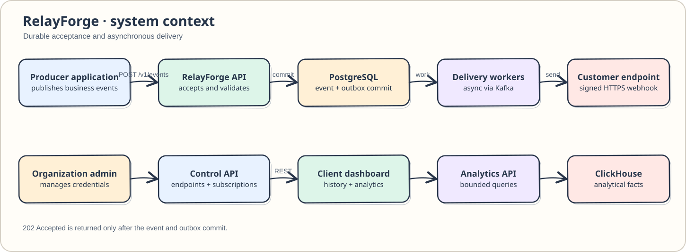
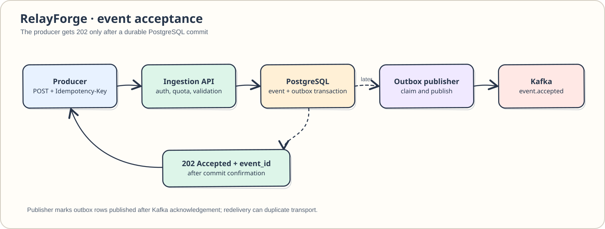
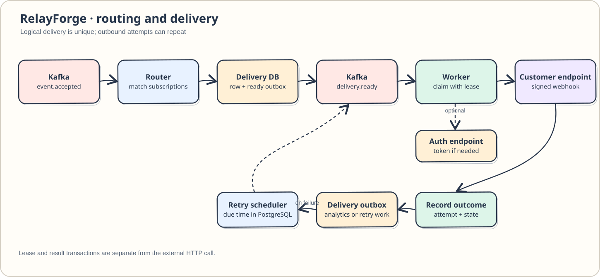
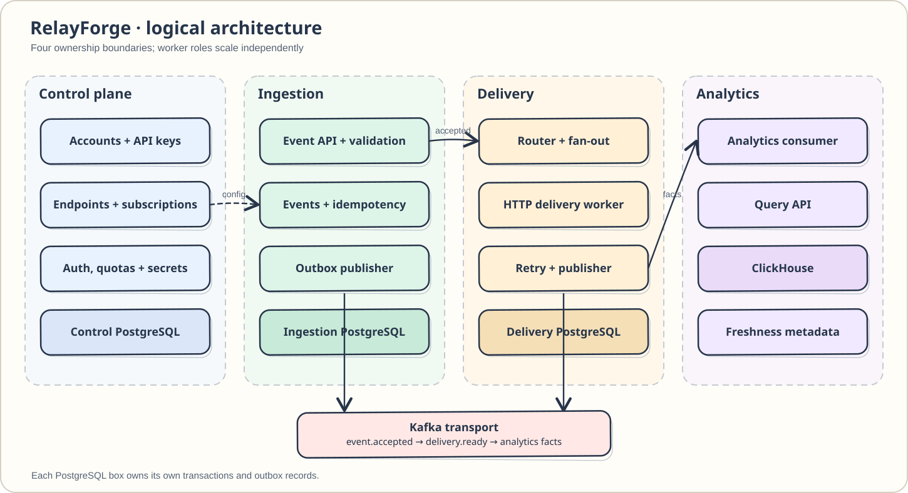

# RelayForge

## Description of the project

RelayForge is a webhook delivery platform. Customers configure organizations, API keys, endpoints, and subscriptions; producers submit events with idempotency keys. The system durably accepts events, routes them to matching endpoints, retries eligible failures, and records delivery history and analytics. This repository contains Spring Boot service and worker modules, database migrations, and a Docker Compose development stack. The local end-to-end flow and failure cases are covered by CI acceptance checks.

## High Level Design

Events enter through the ingestion API and are committed to PostgreSQL with an outbox record. Publishers send committed records to Kafka. The router matches subscriptions and creates delivery work; delivery workers make webhook attempts and schedule retries. Delivery facts flow to ClickHouse for analytics. PostgreSQL owns accepted events and active delivery state, while Redis holds short-lived coordination state.









## Tech Stack

| Technology | Role |
|---|---|
| Java 21, Spring Boot, Maven | APIs, workers, and multi-module build |
| PostgreSQL 17, Flyway | Service-owned data, outboxes, and migrations |
| Apache Kafka | Event and delivery-work transport |
| Redis | Short-lived quota and coordination state |
| ClickHouse | Delivery analytics |
| WireMock | Local webhook receiver simulation |
| Docker Compose | Local application and dependency stack |

## Load Estimates

The planning model assumes 100 customer accounts, 10,000 active endpoints, three deliveries per accepted event, and 1.1 outbound attempts per delivery. Estimated outbound attempts per second equal accepted events per second × 3 × 1.1.

| Profile | Accepted events/s | Estimated outbound attempts/s |
|---|---:|---:|
| Normal | 5,000 | 16,500 |
| Peak | 10,000 | 33,000 |
| Headroom | 15,000 | 49,500 |

These figures are design targets, not measured capacity. At the continuous normal rate for 90 days, they imply about 38.88 billion events, 116.64 billion deliveries, and 128.30 billion outbound attempts. Final capacity and shard counts depend on load testing.

## Local Setup

Run the commands from the repository root with Docker and Docker Compose available. Generate the ignored `.env` once; the script refuses to replace an existing file. If an existing `.env` lacks newly added settings, run `python3 scripts/create-env.py --add-missing`. Review `.env.example` for the available local settings. Keep all credentials and connection URLs in `.env` and use an external secret manager for production.

The root Compose file starts the application roles, PostgreSQL, Kafka, Redis, ClickHouse, and the webhook simulator. The ingestion HA overlay adds a PostgreSQL primary and standby and enables standby-backed event acceptance. Start the complete local system with:

```bash
python3 scripts/create-env.py
docker compose -f compose.yaml -f deploy/ingestion-ha/compose.yaml config --quiet
COMPOSE_PARALLEL_LIMIT=2 docker compose -f compose.yaml -f deploy/ingestion-ha/compose.yaml up -d --build --wait --wait-timeout 600
docker compose -f compose.yaml -f deploy/ingestion-ha/compose.yaml ps
```

The `up` command builds and starts all application services in detached mode and waits for services to be running or healthy. Kafka topic initialization and ingestion HA setup are one-time Compose jobs that exit successfully. With the example port settings, the control, ingestion, delivery, and analytics APIs are available on `127.0.0.1` ports `18080`–`18083`; the webhook simulator uses `18084`. PostgreSQL, Kafka, and ClickHouse use ports `15432`, `19092`, and `18123`.

Run the end-to-end acceptance flow against the running HA stack with `python3 scripts/verify-j1.py`. It provisions a test organization, accepts an event, verifies delivery to the local simulator, and checks the analytics result. Java 21 and a running Docker daemon are required for `mvn verify`, which runs the unit and container-backed integration suites. CI also runs clean boot, restart, dependency outage, HA, and security checks.

```bash
docker compose -f compose.yaml -f deploy/ingestion-ha/compose.yaml down
```

`down` stops the stack and retains its named data volumes.

To discard disposable local data, add `-v` to `down`. This deletes the project's named PostgreSQL, Kafka, Redis, ClickHouse, and ingestion HA volumes.

## Local Scope

The Compose stack runs on one host with one Kafka broker and one logical ingestion and delivery shard. Bucket moves are not enabled. PostgreSQL promotion and backup/WAL restore are tested as operator-controlled drills; automated production failover detection, write-endpoint switching after promotion, off-host backup storage, and a production recovery policy are not supplied by this setup. Endpoint encryption uses local-only keys from `.env`; production key management is deferred. ClickHouse is a single-node instance. The normal, peak, and headroom figures above remain unverified until the deferred J3 load benchmarks; this local stack is for functional development and acceptance testing.

## Project Folder Structure

```text
RelayForge/
├── compose.yaml                     Main local stack
├── .env.example                     Local configuration keys
├── pom.xml                          Maven reactor
├── relayforge-control-plane/        Organizations, keys, and endpoints
├── relayforge-control-publisher/    Configuration outbox publisher
├── relayforge-ingestion/            Event acceptance and queries
├── relayforge-ingestion-publisher/  Accepted-event outbox publisher
├── relayforge-router/               Subscription matching and fan-out
├── relayforge-delivery-api/         Delivery reads
├── relayforge-delivery-worker/      Webhook attempts
├── relayforge-delivery-publisher/   Delivery outbox publisher
├── relayforge-retry-scheduler/      Retry and lease recovery
├── relayforge-analytics-consumer/   Delivery facts into ClickHouse
├── relayforge-analytics-api/        Analytics queries
├── relayforge-api-support/          Shared HTTP support
├── relayforge-consumer-support/     Shared Kafka consumer support
├── relayforge-contracts/            Cross-service contracts
├── relayforge-db-migration/         Flyway startup support
├── relayforge-outbound-security/    Outbound request safeguards
├── relayforge-outbox-support/       Shared outbox support
├── relayforge-runtime/              Runtime configuration
├── relayforge-schema-tests/         Database migration checks
├── deploy/                          Images, database setup, and HA overlay
├── docs/                             Diagrams, decisions, and schema notes
├── load-tests/                       Capacity workloads
└── scripts/                          Local setup and verification helpers
```
