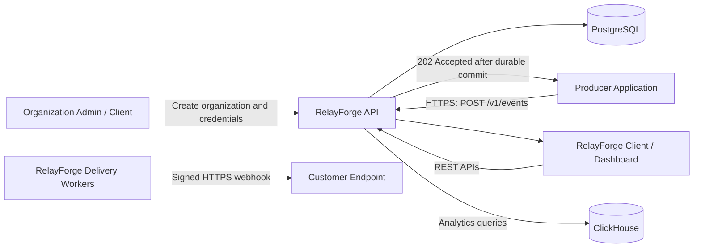
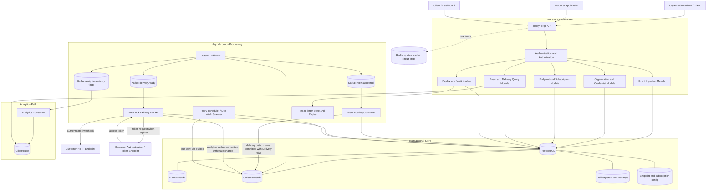
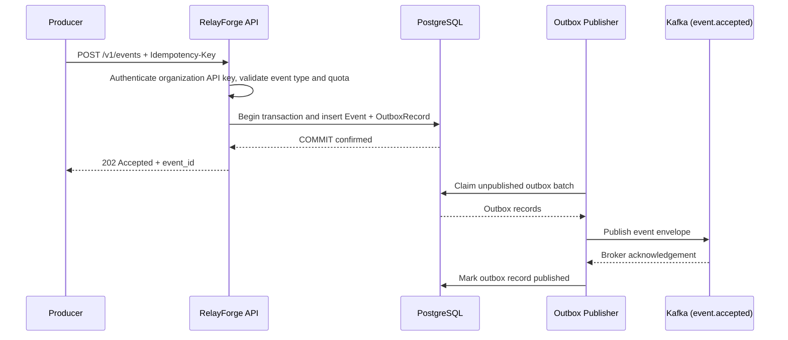
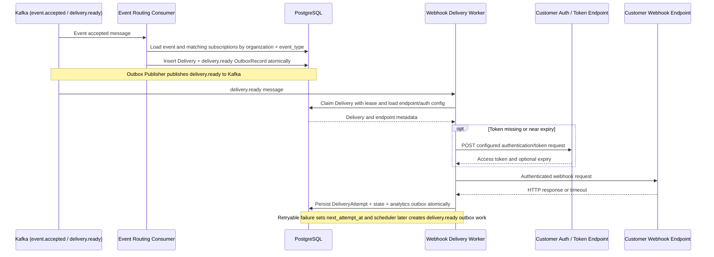

# RelayForge — High-Level Design

**Document version:** 3.3
**Status:** Baseline for implementation  
**Aligned documents:** RelayForge Low-Level Design v1.6; RelayForge Implementation Checklist
**Primary stack:** Java 21, Spring Boot, PostgreSQL, Kafka, Redis, ClickHouse

---

## 1. Purpose

RelayForge is a webhook delivery platform that accepts business events, durably records them, routes them to subscribed HTTP endpoints, retries transient failures, and exposes delivery history and analytics.

This document describes the system boundary, logical components, data flow, deployment units, storage responsibilities, reliability model, and major design decisions. It intentionally stays at high-level design; class-level design, exact schemas, and implementation details belong in the LLD.

## 2. Goals and non-goals

### Goals

- Provision organizations and issue revocable API credentials.
- Register webhook endpoints with destination metadata, authentication configuration, and one or more event types.
- Durably accept a published event before acknowledging it to the producer.
- Route each accepted event to active endpoint subscriptions matching its event type.
- Deliver signed HTTP webhooks asynchronously.
- Retry transient failures with bounded exponential backoff and jitter.
- Recover in-progress work after process crashes.
- Expose event and delivery history, replay, and operational analytics.
- Protect the platform with authentication, authorization, quotas, SSRF defenses, and resource limits.
- Scale ingestion, publication, delivery, and analytics independently where needed.

### Non-goals for the first version

- Active-active multi-region operation.
- Exactly-once external business effects.
- Guaranteed global ordering or guaranteed per-endpoint ordering.
- A visual workflow builder or arbitrary user-defined code execution.
- Dedicated infrastructure per customer account.
- Additional customer-specific services or infrastructure without a measured need.

## 3. Architecture principles

1. **PostgreSQL is authoritative.** Accepted events, outbox records, delivery state, attempts, configuration, and audit records live in PostgreSQL.
2. **Use the transactional outbox.** Event acceptance and publication intent commit in one PostgreSQL transaction; the application does not dual-write directly to PostgreSQL and Kafka.
3. **Kafka transports work; it is not the source of truth.** Consumers must tolerate repeated messages and recover from redelivery.
4. **Delivery is at-least-once.** RelayForge may send a duplicate request if the receiver processed it but RelayForge did not record the success. The stable `delivery_id` can be used by receivers as a deduplication key.
5. **Separate the control path from the delivery path.** API/configuration operations should not wait for customer endpoints to respond.
6. **Scale by workload.** Ingestion, outbox publishing, delivery workers, and analytics consumers can have different replica counts.
7. **Separate ownership from runtime roles.** Four domain services own their data; routing, HTTP delivery, scheduling, and publication run as independently scalable roles within those boundaries.
8. **Shared infrastructure, scoped access.** Customer-owned records are scoped by an internal organization/account ID; all authorization and quota checks are server-side. This does not imply separate databases or deployments per customer.

## 4. System context



**External actors**

- **Producer application:** sends business events to RelayForge.
- **Customer endpoint:** receives webhook requests and returns HTTP responses.
- **Platform operator:** manages service health and operational controls through restricted operator access; operator APIs are not part of the public organization API surface.

## 5. Logical architecture

The diagram below describes data flow. Its single API and PostgreSQL
symbols represent the logical interface and authoritative storage;
the physical service and database boundaries are defined in §8 and §13.



The diagram shows logical responsibilities, not a requirement to deploy every box independently. `Event Routing Consumer`, `Retry Scheduler`, and `Webhook Delivery Worker` can initially be modules/processes within a small number of deployables, provided they can be scaled and operated appropriately.

## 6. Component responsibilities

### 6.1 RelayForge API

**Role:** Public REST entry point under `/v1` and internal composition boundary for control-plane operations.

Responsibilities:

- Validate request shape, payload size, authentication, and permissions.
- Assign/propagate `X-Request-Id` and structured correlation fields.
- Apply rate limits and account-scoped quotas.
- Expose organization, endpoint registration, event publishing, delivery, replay, and analytics APIs.
- Return `202 Accepted` for event ingestion only after the event and outbox record commit.
- Avoid performing webhook HTTP calls inline with an ingestion request.

**Initial deployment:** One Spring Boot application with modular packages. The API can be scaled horizontally behind a load balancer.

### 6.2 Organization and Credential module

- Creates an organization/account record and issues an API key once at creation time.
- Stores only a secure hash of API keys; supports rotation and revocation.
- Returns the organization identifier and credential metadata; never returns the stored secret again.
- Applies organization-scoped quotas and lifecycle state.

### 6.3 Authentication and Authorization module

- Validates API credentials and scopes.
- Maps credentials to an internal organization/account identifier and permitted actions.
- Enforces organization scope in every repository/service operation.
- Never trusts a client-supplied organization ID as proof of access.
- Keeps operator credentials/scopes separate from producer API credentials.

### 6.4 Endpoint and Subscription module

- Registers endpoint destination configuration: `base_url`, path/slug, query parameters, non-secret headers, metadata, timeout, and concurrency configuration.
- Stores a selected authentication strategy, including static API key/Basic/Bearer/custom headers or token exchange/OAuth client credentials. Sensitive values are encrypted or held through a secret-manager reference.
- Associates one or more `event_type` values with the endpoint. Registration returns an `endpoint_id` and the registered event types; event types are routing keys, not endpoint identifiers.
- Manages subscriptions from `event_type` to endpoint and optional restricted filters.
- Validates destinations and applies SSRF protections, including unsafe address resolution and redirects.
- Stores webhook signing secrets encrypted or via a secure secret reference; returns a newly generated secret only once.

### 6.5 Event Ingestion module

For `POST /v1/events` (the publish API):

1. Authenticate the producer using its organization API key and derive the organization scope from that credential.
2. Validate `event_type`, `occurred_at`, `schema_version`, and JSON `data`; verify that the organization is allowed to publish that event type.
3. Resolve the `Idempotency-Key` within the authenticated organization scope.
4. In one PostgreSQL transaction, insert the `Event` and corresponding `OutboxRecord`.
5. Commit, then return `202 Accepted` with `event_id` and `status=accepted`. This is the synchronous contract: validate and durably accept, but do not wait for Kafka routing, token acquisition, or the external webhook response.

If the same idempotency key is used with a different request body, return `409 IDEMPOTENCY_KEY_REUSED`. If PostgreSQL cannot confirm a durable commit, do not acknowledge successful acceptance.

### 6.6 Outbox Publisher

- Reads unpublished outbox records using bounded batches and safe concurrent claiming.
- Publishes records to the appropriate Kafka topic based on the outbox event type: `event.accepted`, `delivery.ready`, or `analytics.delivery-facts`.
- Marks an outbox record as published only after the configured broker acknowledgement.
- Retries publication failures; duplicate Kafka messages are expected and must be safe.
- Exposes backlog age, publish error rate, and throughput metrics.

The outbox publisher is the bridge between PostgreSQL's committed state and Kafka. It prevents event loss caused by a crash between database commit and message publication.

### 6.7 Event Routing Consumer

- Consumes event references from Kafka.
- Loads event metadata and finds active endpoint subscriptions matching the event type within the event's organization scope.
- Applies supported subscription filters.
- Creates one logical `Delivery` per matching `(event_id, endpoint_id)` pair, protected by a uniqueness constraint.
- In the same PostgreSQL transaction, writes a `delivery.ready` outbox record for each newly created delivery. The outbox publisher later publishes those records to Kafka.
- Is idempotent: processing the same event message again must not create duplicate logical deliveries or duplicate logical work.

Routing may be retried independently of webhook attempts. If no active subscription matches, the event remains accepted and has zero deliveries.

### 6.8 Webhook Delivery Worker

- Claims due `Delivery` records using durable state transitions and expiring leases.
- Enforces endpoint-level and account-level concurrency limits.
- Resolves the registered endpoint configuration and builds the target URL from its base URL, path/slug, and configured query parameters.
- Applies the configured authentication strategy. For token-based strategies, it reuses a valid cached token where possible; otherwise it calls the configured authentication endpoint, extracts the token from the response, and caches it according to the configured/validated expiry policy.
- Retries transient token-acquisition failures with exponential backoff and jitter, up to five retries after the initial attempt (six attempts total), subject to bounded timeouts and the delivery deadline. Authentication-stage failures are recorded separately from target delivery attempts.
- Builds the outbound request with stable `delivery_id`, event metadata, configured headers, the required auth material, and any configured webhook signature headers.
- Applies strict connection/read timeouts, bounded response-body capture, and safe redirect behavior.
- Records the attempt, HTTP status, duration, and sanitized error details.
- Marks success for configured successful HTTP responses; schedules retry for network errors, timeouts, `408`, `429`, and selected `5xx`; treats most other `4xx` responses as terminal by default.
- Does not hold a database transaction open while waiting for the customer endpoint.

The worker should claim work, commit the claim, perform the network request, then persist the result. A worker crash after the remote server processes a request can still cause a duplicate after lease expiry; this is an inherent at-least-once delivery trade-off.

### 6.9 Retry Scheduler / Due-Work Scanner

- Finds deliveries whose `next_attempt_at` is due and whose state allows another attempt.
- In a bounded, concurrency-safe transaction, marks due work as enqueued and inserts a `delivery.ready` outbox record. The outbox publisher moves it to Kafka; the scheduler never dual-writes directly to Kafka.
- Applies exponential backoff with jitter and respects valid `Retry-After` values within configured limits.
- Moves deliveries that exceed the attempt count or retry horizon to dead-lettered state.
- Recovers expired worker leases after crashes.

The scheduler must not become a tight full-table polling loop. Use indexed due-work queries, bounded batches, and measurement-driven polling intervals. A future design may use a delayed-message mechanism, but PostgreSQL remains authoritative for retry state.

### 6.10 Replay and Audit module

- Allows authorized users to replay a dead-lettered delivery or explicitly selected failed delivery.
- Creates an auditable replay action and defines whether replay reuses the logical `delivery_id` or creates a new delivery generation. The LLD must settle this policy before implementation.
- Prevents replay from bypassing quotas, destination validation, or concurrency limits.
- Makes repeated replay requests idempotent where practical.

### 6.11 Analytics Pipeline

- Consumes delivery-state/attempt facts from the dedicated `analytics.delivery-facts` Kafka topic, separate from event-routing and delivery-work messages.
- Delivery state/attempt changes and their analytics outbox records are committed in the same PostgreSQL transaction; the outbox publisher publishes analytics facts without an unsafe database/Kafka dual write.
- Writes append-oriented facts and aggregates to ClickHouse.
- Supports time-series counts, success/failure rate, latency percentiles, attempts, dead-letter counts, and usage summaries.
- Exposes `data_as_of` or equivalent freshness metadata to clients.
- Treats duplicate facts as possible and designs the table/aggregation strategy to handle replay or reprocessing.

ClickHouse is not authoritative for individual delivery state. A dashboard can lag or be temporarily unavailable without blocking event acceptance or webhook delivery.

### 6.12 Redis

Use Redis only for short-lived coordination and acceleration:

- Rate-limit counters and burst control.
- Selected hot dashboard cache entries.
- Short-lived circuit-breaker or endpoint health state, if useful.

Do not store the only copy of an accepted event, delivery state, or worker ownership in Redis. Define conservative rate-limit behavior during Redis failure; authorization must not depend on stale cached permission state.

## 7. Main data flows

### 7.1 Event acceptance and durable publication



### 7.2 Routing and delivery



Delivery-work and analytics publication use transactional outbox records. This avoids a non-atomic PostgreSQL/Kafka dual write. The retry scheduler uses PostgreSQL as the authority for due times and inserts outbox records when work becomes eligible again.

### 7.3 Analytics

1. Delivery state transitions and attempts produce analytics facts.
2. Facts are published through a recoverable event path and consumed asynchronously.
3. The analytics consumer writes facts/aggregates to ClickHouse.
4. Dashboard APIs query ClickHouse with organization-scoped predicates and bounded time ranges.
5. The response includes freshness information; a specific delivery lookup reads PostgreSQL.

## 8. Deployment view

### Planned deployables

| Deployable | Responsibilities | Scaling signal |
|---|---|---|
| `relayforge-control-plane` | Organizations, credentials, endpoint/subscription configuration | Configuration API latency and change propagation |
| `relayforge-ingestion` | Event API, idempotency, payload storage, accepted-event outbox | Accepted events/s, commit latency, event backlog |
| `relayforge-ingestion-publisher` | Ingestion outbox to Kafka | Accepted-event outbox age |
| `relayforge-router` | Subscription projection, fan-out, delivery creation | Routing lag, delivery DB write latency |
| `relayforge-delivery-worker` | Bounded outbound HTTP and authoritative result recording | Due backlog, attempt rate, receiver latency |
| `relayforge-delivery-publisher` | Delivery outbox to Kafka | Delivery/analytics outbox age |
| `relayforge-retry-scheduler` | Due retries and expired-lease recovery | Oldest overdue work, scan duration |
| `relayforge-analytics-consumer` | Delivery facts into ClickHouse | Analytics Kafka lag, ClickHouse insert latency |
| `relayforge-analytics-api` | Bounded organization-scoped analytical queries | Query p95, concurrency, ClickHouse load |

Control plane, ingestion, delivery, and analytics are the four ownership boundaries. The publisher, router, worker, and scheduler images can scale independently while using their owning service's storage and contracts. Each image needs functional Docker tests; actual replica counts come from the final benchmark.

### Shared platform dependencies

- Service-owned PostgreSQL storage with backups, migrations, connection pooling, and a documented partition/shard plan; physical cluster count remains a capacity decision.
- Kafka cluster/topics with replication appropriate to the environment. A single-broker local profile is development-only.
- Redis for cache/limits/ephemeral state.
- ClickHouse for analytics facts and queries.
- Load balancer/reverse proxy and TLS termination in front of `relayforge-api`.
- Metrics/logging/tracing stack and a repeatable load-test environment.

### Example repository/module naming

```text
relayforge/
├── relayforge-control-plane/
├── relayforge-ingestion/
├── relayforge-ingestion-publisher/
├── relayforge-router/
├── relayforge-delivery-worker/
├── relayforge-delivery-publisher/
├── relayforge-retry-scheduler/
├── relayforge-analytics-consumer/
├── relayforge-analytics-api/
├── relayforge-contracts/           # versioned messages; no shared domain logic
├── deploy/
├── docs/
│   ├── high-level-design.md
│   └── decisions/
└── load-tests/
```

Keep shared code to versioned contracts and transport helpers. Each domain service owns its schema and migrations; Docker images are built for each deployable role.

## 9. Data ownership and storage boundaries

| Data | System of record | Notes |
|---|---|---|
| Organization/account metadata and API credentials | PostgreSQL | API keys stored as hashes; raw key shown only once at creation |
| Endpoints, auth profiles, and event-type subscriptions | PostgreSQL | URL validation, encrypted secrets/secret references, organization-scoped access |
| Accepted event payload and idempotency key | Ingestion-owned PostgreSQL | Event history expires after 90 days; the idempotency registry has its own 90-day key lifetime |
| Publication intent | PostgreSQL outbox records | Atomic with event acceptance, delivery creation, or delivery-state transition as applicable |
| Event and delivery routing state | Delivery-owned PostgreSQL | Event-related history expires with its acceptance cohort |
| Delivery attempts and retry schedule | Delivery-owned PostgreSQL | Authoritative state while active; historical rows expire with their event |
| Work transport | Kafka topics `event.accepted`, `delivery.ready`, `analytics.delivery-facts` | Messages may repeat; consumers must be idempotent |
| Rate-limit/cache/circuit state | Redis | Ephemeral; never authoritative for delivery |
| Delivery facts and aggregates | ClickHouse | Eventually consistent; analytics-only |

### Key constraints

- Enforce `(organization_id, idempotency_key)` uniqueness for 90 days in a shard-local registry committed with event and outbox, independent of event-history time partitions.
- Unique `(event_id, endpoint_id)` for one logical delivery per matching endpoint, unless replay semantics explicitly create a new generation.
- Organization-scoped access in every query; an opaque ID is not authorization.
- Index due-work scans by status and `next_attempt_at`; avoid unbounded scans.
- Index event/delivery history by account scope and time.
- Store bounded, sanitized response details; avoid retaining full remote response bodies by default.

## 10. Reliability and failure handling

| Failure | Expected behavior |
|---|---|
| API process crashes before transaction commit | No successful acceptance response; producer may retry with the same idempotency key |
| API crashes after commit but before response | Producer may retry; idempotency returns the original logical event |
| PostgreSQL unavailable | Do not acknowledge new events as accepted; return a retryable service error |
| Outbox publisher crashes after Kafka publish but before marking published | Message can be published again; consumers must be idempotent |
| Kafka unavailable | Outbox accumulates durably in PostgreSQL; ingestion can continue only while DB/storage and configured backlog limits allow it |
| Routing consumer crashes | Kafka redelivery/restart reprocesses safely; unique constraints prevent duplicate logical deliveries |
| Worker crashes before sending | Lease expires and delivery can be retried |
| Worker crashes after endpoint processes request but before success is recorded | Duplicate webhook may be sent; receiver deduplication by `delivery_id` is required |
| Customer endpoint times out or returns retryable status | Record attempt and schedule bounded retry with backoff/jitter |
| Customer endpoint is permanently failing | Circuit/concurrency controls protect workers; delivery eventually becomes dead-lettered |
| Redis unavailable | Use defined fallback/strictness for limits; durable state and authorization remain in PostgreSQL/application logic |
| ClickHouse unavailable | Analytics lag; ingestion and delivery continue; dashboards show unavailable/stale analytics |
| Poison/invalid Kafka message | Bounded retry, observable failure, then quarantine/dead-letter path; never silently discard |

## 11. Security and isolation boundaries

- Authenticate every public API request; enforce action scopes and account ownership.
- Derive the organization/account scope from validated credentials, never from a trusted client-supplied body field.
- Scope reads and writes by organization ID plus resource identifier; use PostgreSQL row-level security only as defense in depth if enabled and tested.
- Protect credentials and endpoint signing secrets; reveal newly created signing secrets once and support rotation.
- Use HMAC-SHA256 signatures with timestamp/replay-window guidance for receivers.
- Prevent SSRF: reject loopback, private, link-local, multicast, and cloud metadata destinations; validate DNS results and revalidate redirects or disable redirects.
- Enforce timeouts, payload limits, response-body limits, concurrency caps, and per-account quotas.
- Sanitize logs and analytics; do not put secrets or full sensitive payloads in metrics.
- Separate operator access from producer-facing API credentials.

## 12. Observability

### Metrics

- API request rate, error rate, p50/p95/p99 latency, quota rejections.
- PostgreSQL connection pool utilization, transaction latency, slow queries, lock waits.
- Outbox pending count, oldest pending age, publish failures and throughput.
- Kafka consumer lag, partition skew, rebalance count, publish errors.
- Routing throughput, matched subscriptions per event, delivery creation conflicts.
- Due delivery backlog, oldest overdue delivery, attempt rate, success/failure rate, retries, dead-letter count.
- Customer endpoint latency, timeout rate, response status distribution, per-endpoint concurrency saturation.
- ClickHouse ingestion lag and dashboard `data_as_of` age.
- Redis availability and rate-limit fallback events.

### Correlation

Propagate `request_id`, `event_id`, `delivery_id`, `endpoint_id`, and account scope through logs and traces where safe. Avoid high-cardinality metric labels for raw IDs; use those IDs in logs/traces instead.

### Alerts

Alert on growing outbox age, Kafka lag, old overdue deliveries, high retry/dead-letter rate, PostgreSQL saturation, repeated worker lease recovery, and analytics freshness exceeding the target.

## 13. Capacity and scaling approach

The following are **planning assumptions, not measured guarantees**. Keep account count and endpoint count separate from throughput: neither determines event rate by itself. Assume 100 accounts, 10,000 active endpoints, average fan-out 3, and 1.1 outbound attempts per delivery. The attempted-request rate is `accepted events/s × 3 × 1.1`.

| Profile | Accepted events/s | Estimated outbound attempts/s | Planning meaning |
|---|---:|---:|---|
| Normal | 5,000 | 16,500 | Sustained target |
| Peak | 10,000 | 33,000 | Burst target; duration selected for final tests |
| Capacity headroom | 15,000 | 49,500 | Additional 5,000 events/s above peak; final capacity test |

At 5,000 events/s continuously for 90 days, expect 38.88 billion events, 116.64 billion logical deliveries, and about 128.30 billion outbound attempts before auxiliary rows. Even a 1 KiB average payload implies about 39.81 TB of raw payload bytes, excluding replicas, indexes, WAL, metadata, and backups. These are arithmetic planning figures, not storage benchmarks. A 50,000 virtual-user test is not equivalent to 50,000 QPS.

Headroom is 50% above peak admission, not an automatic autoscaling promise. At 200 ms mean in-flight time, the three profiles imply roughly 3,300, 6,600, and 9,900 concurrent outbound attempts; at 1 second, five times as many. Define arrival shape, receiver latency distribution, failures, tenant skew, payload size, accepted-event p95/p99, delivery lag, and permissible backlog drain time in the final benchmark. If processing capacity falls below arrivals, throttle admission before durable backlogs exceed the tested recovery envelope.

**Technology decisions for this profile:** PostgreSQL remains the transactional authority for acceptance, uniqueness, and active delivery state. Time partition high-volume history from the first physical schema so expired cohorts can be detached and dropped. Plan independent ingestion and delivery write shards because partitioning within one primary does not distribute writes. Keep control-plane data separate. Kafka remains transport for independently scaled consumers; Redis remains cache/coordination; ClickHouse remains analytical storage with its current retention policy unchanged. Hardware sizes and shard counts require measured write, WAL, disk, and tenant-skew data.

### PostgreSQL lifecycle and topology

The **90-day UTC clock starts at RelayForge acceptance**, not customer-supplied `occurred_at`. `organizations`, `api_keys`, `users`, `endpoints`, and `subscriptions` remain until their own account/configuration lifecycle applies. Published `events`, `deliveries`, `delivery_attempts`, `authentication_attempts`, and `replay_requests` expire as one event cohort. Account and configuration `audit_records` have a separate policy; any event-specific audit detail must follow the event-history policy. Replay is unavailable after the source event expires.

Use daily time partitions for historical event and delivery tables, with an immutable acceptance-day key copied to related rows. Pre-create partitions; remove a fully expired day only after checking dependent work, then detach and drop it. Use bounded deletion for the cutoff day or define and monitor a short physical-deletion grace period. Time-partitioned primary/unique keys must contain the partition key, so the LLD's current UUID-only and `(organization_id, idempotency_key)` constraints are logical contracts, not deployable partitioned DDL.

Route an ingestion request by a stable hash of `(organization_id, idempotency_key)` to one write shard. That shard commits a 90-day idempotency-registry entry, event, and outbox record atomically. The registry retains a unique key across daily event partitions and needs bounded expiry and its own write/delete benchmark. Carry a versioned shard locator in event and delivery identifiers/messages; route delivery state consistently using the event locator. This distributes a hot organization's distinct keys across shards. Rebalancing, locator versioning, payload retrieval, and cross-service ownership checks are required LLD contracts; no cross-service foreign keys or transactions.

Each production write shard has a primary, at least one standby, backups, and tested failover. Standbys provide availability and optional read capacity, not additional write capacity. Ingestion requires synchronous WAL confirmation on a standby before `202`; if no synchronous standby is available, fail acceptance with a retryable error rather than silently weaken durability. This increases commit latency and can reduce availability; measure the tradeoff. An asynchronous promoted standby can miss an already acknowledged commit. Use the primary for authoritative immediate reads. Confirm shard count with final load tests. [PostgreSQL replication guarantees](https://www.postgresql.org/docs/current/warm-standby.html).

Published outbox rows may be removed on a shorter operational schedule after broker acknowledgment and recovery checks. Pending/in-flight rows are never purged merely by age: alert, recover or explicitly terminate the work before its event cohort is removed. Kafka retention, backups, logs, and external payload copies need their own lifecycle; this decision does not change ClickHouse retention.

**Service boundaries:** `control-plane` owns accounts, API keys, endpoint/subscription configuration, and secrets; `ingestion` owns idempotency, accepted events, payloads, and its outbox; `delivery` owns routing progress, logical deliveries, attempts, retries, replay, and its outbox; `analytics` owns analytical ingestion and queries. Routing, outbound HTTP workers, scheduler, and each outbox publisher are separately deployable processes within their owning service and have separate Docker images and scaling signals. Services exchange versioned events or bounded read APIs; they do not write another service's tables. Delivery must have a versioned configuration projection or bounded control-plane read, and a durable payload retrieval contract. Cross-service foreign keys and cross-service transactions in the current LLD schema must be replaced before implementation of independently owned databases. Preserve `202` only after the ingestion event/outbox transaction commits.

**Capacity design gate:** Before Milestone A, finish the LLD physical DDL for shard-local idempotency, composite cohort keys, payload retrieval, routing snapshots, retained-work expiry, and failover. A shared PostgreSQL schema is suitable for Docker functional tests, not evidence that this profile will fit on one primary. Run the full normal/peak/headroom load suite only after every feature and end-to-end test passes. If the final benchmark misses targets, revise the topology or admission limits; do not claim capacity from design alone.

Implementation facts underlying these choices: [PostgreSQL composite constraints and foreign keys](https://www.postgresql.org/docs/current/ddl-constraints.html), [PostgreSQL partitioning and retention tradeoffs](https://www.postgresql.org/docs/current/ddl-partitioning.html), [Kafka consumer group partition assignment and poll behavior](https://kafka.apache.org/43/javadoc/org/apache/kafka/clients/consumer/KafkaConsumer.html), and [ClickHouse replacement semantics](https://clickhouse.com/docs/en/guides/replacing-merge-tree).

Scale in this order, guided by measurements:

1. Keep API handlers short; tune connection pools, payload validation, and PostgreSQL indexes.
2. Batch outbox claims and Kafka publication while preserving recoverability.
3. Increase routing and delivery worker concurrency independently; protect PostgreSQL with bounded concurrency.
4. Partition Kafka topics based on measured throughput and skew; choose keys based on the ordering/fairness contract.
5. Benchmark bounded ClickHouse dashboard queries; compare their cost and latency with PostgreSQL summaries before fixing the analytics storage choice.
6. Add caching only for measured hot reads; do not cache authoritative delivery state without a clear invalidation/freshness policy.
7. Validate the planned partition and shard boundaries against measured row sizes, write amplification, query plans, retention, and tenant skew before declaring a production topology.

Benchmark reports must record payload size, fan-out, receiver latency, failure mix, retry rate, hardware, database configuration, topic/partition count, test duration, and load-generator capacity. Do not publish target figures as achieved performance until measured.

## 14. Consistency and delivery guarantees

- **Event acceptance:** `202 Accepted` means the event and outbox record committed in PostgreSQL. It does not mean the customer endpoint received the webhook. Synchronous checks are completed before the response; webhook delivery remains asynchronous.
- **Publication:** at-least-once publication from the outbox to Kafka; duplicates are expected.
- **Routing:** one logical delivery per event-endpoint pair, enforced by durable uniqueness and idempotent processing.
- **Webhook execution:** at-least-once HTTP attempts; duplicate requests can occur. RelayForge cannot guarantee exactly-once external side effects.
- **Delivery status:** PostgreSQL is authoritative for individual delivery details.
- **Analytics:** ClickHouse is eventually consistent; expose freshness metadata.
- **Ordering:** no global ordering guarantee in the first version. Kafka partitioning alone does not guarantee end-to-end endpoint ordering if retries and parallel workers reorder attempts.

## 15. API and routing contract (HLD-level)

### 15.1 Organization creation

- `POST /v1/organizations` creates an organization and returns `organization_id` plus a newly generated API key exactly once. Store only a secure hash of the key. Organization creation should be restricted to an approved signup/bootstrap flow, not left open without abuse controls.
- Subsequent requests authenticate with `Authorization: Bearer <organization_api_key>` (or the final chosen API-key header convention). The server derives organization scope from the credential; callers cannot select another organization by sending an ID in the request body.
- Key rotation creates a new credential and supports revocation of the old credential. Organization creation should be rate-limited and protected against abuse.

### 15.2 Endpoint registration

- `POST /v1/endpoints` registers a destination with `base_url`, path/slug, query parameters, headers/metadata, authentication strategy, and one or more `event_types`. The response returns `endpoint_id`, registered `event_types`, and status. `endpoint_id` identifies the destination configuration; an `event_type` is the logical routing key used when publishing an event. The per-event `event_id` is generated later by RelayForge when a publish request is accepted. Neither `endpoint_id` nor `event_type` is an authorization credential.
- A registration may optionally validate configuration without making a live outbound request. A separate test-connection API can be added later.

### 15.3 Publish event

- `POST /v1/events` accepts `event_type`, `data`, optional `occurred_at` and `schema_version`; clients provide `Idempotency-Key` as a header.
- RelayForge checks organization credentials, quotas, event-type authorization, payload shape/size, and idempotency synchronously. It then atomically inserts the event and outbox record.
- Return `202 Accepted` after the durable transaction commits, with `event_id` and accepted status. Do not return `200 OK` to imply the webhook already ran. The actual external request and its outcome are asynchronous.
- Routing fans the event out to all active endpoints subscribed to the event type within the authenticated organization scope. If no subscription matches, the event remains accepted and the routing outcome records zero deliveries.

### 15.4 Authentication and token exchange

- Each endpoint stores a typed authentication strategy. Token-exchange configuration describes the auth URL, method, headers/body, token JSON path, optional expiry JSON path, and where the token is placed on the destination request.
- Tokens are cached by endpoint/auth-configuration version; refresh before expiry and coordinate concurrent refreshes. Never log credentials or access tokens.
- Token acquisition retries are distinct from webhook delivery retries. For transient auth failures, use exponential backoff with jitter, at most five retries after the initial request, and a bounded total deadline. Non-retryable credential/configuration failures should fail fast or enter a controlled terminal/review state rather than retry forever.
- If a destination returns `401`, invalidate the cached token and permit at most one controlled refresh-and-retry for that delivery, preventing infinite authentication loops.

### 15.5 Analytics event path

- Routing/delivery status changes produce analytics facts through outbox records committed atomically with the relevant PostgreSQL state change. The outbox publisher sends them to the dedicated `analytics.delivery-facts` Kafka topic.
- `relayforge-analytics-consumer` consumes facts idempotently and writes ClickHouse. Analytics lag must not block event acceptance or webhook delivery.

## 16. Final v1 decisions

The following are implementation constraints, not open design questions:

- PostgreSQL is authoritative for organization/configuration, accepted events, deliveries, attempts, leases, outbox records, replay, and audit.
- The event publish transaction inserts `events` and the `event.accepted.v1` outbox row together. Return `202` only after commit.
- Endpoint registration creates the endpoint and all supplied event-type subscriptions in one transaction. Any invalid subscription rolls back the registration.
- Routing uses the authenticated `organization_id` and `event_type`; matching endpoint/subscription IDs are snapshotted when routing occurs.
- The delivery worker checks the endpoint's current status and versioned configuration before sending. A disabled endpoint is not sent to.
- Delivery work is durable through PostgreSQL delivery rows plus outbox messages. Kafka is transport, not authoritative state.
- Delivery is at-least-once. `delivery_id` is stable across attempts within one generation. Replay creates a new delivery ID and increments generation.
- No ordering guarantee is provided in v1.
- Any 2xx is successful by default. HTTP 408/429, transient network failures, and 5xx are retryable; other 4xx are terminal by default. Respect valid `Retry-After` within configured limits.
- Token acquisition allows an initial attempt plus up to five retries for transient failures within a 90-second deadline; permanent configuration failures fail fast.
- Token-cache keys include organization, endpoint, auth-configuration version, and credential version. Use TTL jitter, local single-flight, per-key distributed coordination, cache re-check after lock acquisition, and early refresh.
- Quotas live in `organizations.quota_config`; Redis is a cache/coordination layer. Redis failure uses bounded fallback and safe platform limits. Quota-sensitive writes fail closed when PostgreSQL is unavailable.
- ClickHouse analytics use `relayforge_analytics.delivery_facts` with `ReplacingMergeTree(version)`. Duplicate facts reuse the same `fact_id` and `version`; query-time deduplication is used where required.
- Published events and delivery history have a 90-day acceptance-based lifecycle with tested partition removal and bounded cutoff cleanup. Idempotency keys remain unique for 90 days; reuse after expiry is a new event. Account/configuration records remain under separate policies. Purge only published outbox rows after recovery checks; never purge unpublished work by age.
- ClickHouse stores analytical facts only; payloads, secrets, and authoritative delivery state remain outside ClickHouse.
- Secrets use application-level envelope encryption or a configured secret reference. Auth configuration is declarative and allowlisted; no arbitrary scripts or payload interpolation.
- Endpoint URLs are protected against SSRF at registration and delivery: validate DNS/IP targets, reject private/reserved/metadata destinations by default, disable redirects, and enforce egress timeouts.

## 17. Implementation sequence

Implementation and manual verification are tracked in `RelayForge_Implementation_Checklist.md`. Work is ordered so each milestone ends in a runnable Docker checkpoint.

1. Repository, Docker Compose dependencies, migrations, health endpoints, organization provisioning, and API-key validation.
2. Endpoint registration, atomic subscriptions, auth-config validation/encryption, and SSRF-safe URL validation.
3. Event ingestion, idempotency, transactional outbox, and durable `202 Accepted`.
4. Outbox publisher, Kafka contracts, duplicate-safe routing, and delivery creation.
5. Delivery worker, outbound signing/authentication, attempt history, and delivery query APIs.
6. Retry scheduler, leases, crash recovery, dead-lettering, and audited replay.
7. Token exchange, cache coordination, and authentication failure diagnostics.
8. Analytics outbox, ClickHouse DDL/consumer, and analytics APIs.
9. Quotas, security hardening, observability, tested retention cleanup, and operational controls.
10. End-to-end Docker tests, failure injection, and measured load tests.

## 18. HLD exit criteria

The HLD is implementation-ready when deployable boundaries, source-of-truth ownership, transactional boundaries, delivery guarantee, routing behavior, retry/replay semantics, analytics consistency, security boundaries, and non-goals above are reflected in the LLD and automated acceptance tests.

The HLD does not claim implementation or performance benchmarks are complete. Throughput/latency claims must come from reproducible measurements recorded by the implementation checklist.

---

**Status:** Planning baseline for RelayForge v1. LLD v1.6 retains functional contracts; its physical schema gate must pass before the high-volume implementation. Capacity and topology remain subject to benchmark evidence.
